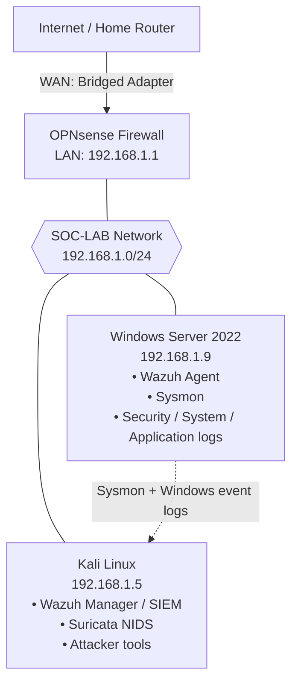

# SOC Home Lab – Network Design

A virtualized SOC lab built in VirtualBox to practice attack simulation, log collection, and detection.

## Network Diagram

## Components

| VM | IP | Role |
|---|---|---|
| OPNsense | 192.168.1.1 | Firewall / gateway (WAN bridged, LAN SOC-LAB) |
| Kali Linux | 192.168.1.5 | Attacker, Wazuh SIEM, Suricata NIDS |
| Windows Server 2022 | 192.168.1.9 | Target with Wazuh agent and Sysmon |

## Log Flow

1. Windows Sysmon, Security, System, and Application logs go through the Wazuh agent to the Wazuh Manager.
2. Suricata alerts (`eve.json`) are forwarded to Wazuh.
3. Wazuh correlates the events and displays them on the dashboard.

## Attack Scenarios (planned)

- Nmap scan
- Brute-force login
- New admin user creation
- Suspicious PowerShell command
